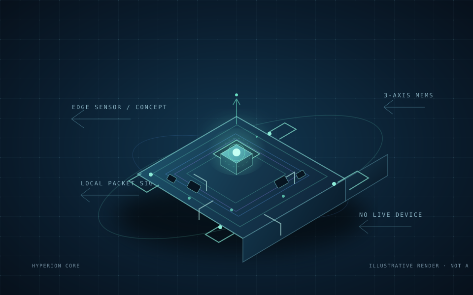

# Hyperion Core

### Japan-focused seismic observability, research, and training interface

**Created by Aniruddha Dhibar**

Hyperion Core is a bilingual English/Japanese prototype that brings a Japan-region earthquake catalog, cited background research, and interactive synthetic signal visualizations together in one operator-oriented dashboard. It is built as an educational systems-engineering project—not as an earthquake predictor or public warning service.



> **Safety notice:** This project is not connected to field sensors, JMA's Earthquake Early Warning (EEW), emergency dispatch, sirens, or infrastructure controls. It must not be used to make emergency or operational decisions. Follow official information from the Japan Meteorological Agency (JMA) and local authorities.

## What you can explore

- **Japan event catalog:** a server-side proxy retrieves the USGS past-hour GeoJSON feed, filters events to a broad Japan-region bounding box, and presents event time, magnitude, depth, coordinates, and a source link. It auto-refreshes every 60 seconds and shows feed-generation and last-check times.
- **Animated interface:** a procedural network-field backdrop, a Japan-centered orbiting globe, service topology, waveform, radar-style visualization, and a rotating isometric sensor concept.
- **About and system tour:** bilingual project context plus a four-step walkthrough separating the USGS catalog from generated training visuals and cited research.
- **Interactive demo reel:** a play/pause scene tour rendered in the browser from the same illustrative globe, waveform, topology, and sensor graphics. It is not a recorded field video.
- **Japan time desk:** live browser-clock views for Japan Standard Time (JST) and UTC.
- **47-prefecture index:** searchable and region-filterable prefecture/capital directory with approximate city-center reference coordinates. These coordinates are not sensor locations.
- **Emergency readiness panel:** links to Tokyo Fire Department 119 guidance and the device phone handler, and states that predictions, sensor telemetry, and emergency-alert delivery are not connected.
- **Installable offline PWA:** caches the app shell and static assets, and stores local notes in browser storage.
- **Local peer communication:** copy/paste WebRTC pairing codes connect two browsers on the same local Wi-Fi/hotspot without cloud signaling. Paired peers can exchange text and use browser audio calls while their local network remains available.
- **Source and update desk:** the latest event in the USGS Japan-region catalog, when present, plus direct links to JMA and USGS primary sources. It does not invent headlines or claim to aggregate official warning news.
- **README language-stack inventory:** all 16 language stacks, their intended roles, and honest implementation status are documented in the architecture table below; the dashboard does not render a language-card section.
- **Original hardware concept art:** an in-repository SVG design illustration for a hypothetical sensor module. It is an illustration, not a photograph of real hardware.
- **Synthetic Nankai training exercise:** replay, pause, reset, and scrub a fictional signal-review sequence; select generated input-noise and station-dropout profiles.
- **Bilingual voice assistant:** ask supported questions by speaking English or Japanese, then play the cited answer with the browser's speech synthesis. The answer set remains curated and is not a generative AI model.
- **Japan preparedness guidance:** an offline curated bilingual answer summarizes earthquake/tsunami basics and Japan's 119 emergency number with links to JMA and Tokyo Fire Department references. It is not dispatch or municipality-specific advice.
- **Synthetic model-training lab:** generate a deterministic toy feature dataset, train a logistic classifier in the browser, review holdout metrics, and export a JSON report. These synthetic scores do not measure real earthquake-prediction skill.
- **Consent-based peer location sharing:** optionally share browser coordinates with the paired peer over the existing local WebRTC data channel. Sharing requires an explicit start action and browser permission, can be stopped at any time, and coordinates are not written to app storage.
- **Local-only message previews:** inspect mock mobile, web, watch, and signage presentations. These are never sent.
- **Polyglot engineering examples:** explore bounded examples and starter modules for sensor framing, DSP, asynchronous inference, scientific modeling, and review eligibility.

All Canvas scenes and the training scenario are illustrative. Animations are not measurements, sensor-status reports, or predictions. The USGS feed contains catalog events that have already been detected and located; it is not a real-time waveform feed or an official Japanese warning channel.

## Run the dashboard

### Requirements

- Node.js 20 or later
- npm

### Development

```powershell
cd apps/dashboard-ui
npm install
npm run dev
```

Open [http://localhost:3000](http://localhost:3000). The Japan-region catalog is fetched through the Next.js server route at `/api/japan-catalog`; the route contacts the USGS past-hour feed. An internet connection is needed for catalog data. If the external feed is unavailable, the dashboard shows an error rather than substituting synthetic events.

## Install and use the offline communication prototype

1. Open the production deployment over HTTPS while online, then install it from the browser prompt. On iOS/iPadOS, use **Share → Add to Home Screen**. Visit the app once after installation so the service worker caches the shell and static assets.
2. With the internet unavailable, put both devices on the same functioning Wi-Fi or personal hotspot. Each device must have opened the app online and cached it first.
3. Device A selects **Create invite** and shares the generated code with Device B through a private, out-of-band method. Device B pastes it and selects **Accept invite · create response**. Device A pastes the response and selects **Apply peer response**.
4. Once connected, messages travel directly over a WebRTC data channel. Unpaired notes remain local to the device. Both peers select **Start voice call** and grant microphone access to send two-way audio.
5. To share location, select **Share my location** while paired and grant the browser's location permission. Coordinates are sent only to that peer on the local connection, displayed transiently, and cleared when sharing stops or the peer disconnects. Either user can stop sharing; the app does not persist location history.

This prototype uses local ICE candidates only; it has no STUN/TURN server, account, cloud signaling, identity verification, or relay. Pairing may fail if the Wi-Fi network blocks peer-to-peer traffic, the router isolates clients, or the browser cannot resolve local candidates. Both devices need a secure browser context (HTTPS; localhost is suitable for development). Browser geolocation also requires a secure context and explicit permission. Sharing a pairing code grants the recipient a chance to join that room and receive opted-in location—share it only with the intended peer. Local notes are stored unencrypted in browser storage; do not use them for secrets, and clear history on shared devices.

### Offline model-training lab

The dashboard's training lab generates a reproducible synthetic two-class feature dataset and fits a small logistic classifier locally in the browser. The held-out split and exported JSON report are demonstrations of an ML workflow only; there are no real waveform inputs, trained seismic models, calibration results, or earthquake-prediction capability. Do not interpret its metrics as a probability of an earthquake or use them for warnings or decisions.

Voice input and output depend on browser speech APIs and installed language voices. Speech recognition may use a browser/vendor service and may require internet access; audio processing and retention are governed by that provider. Hyperion does not store microphone audio. Typing remains available offline, and spoken playback is started only by the user.

The PWA cannot create Wi-Fi, use Wi-Fi Direct or Bluetooth for calling, or bypass a loss of telephone service. A cellular call to 119 still requires an available telephone network. This prototype is not an emergency dispatch, guaranteed communications, or life-safety service; test it only with non-emergency messages.

### Production build

```powershell
cd apps/dashboard-ui
npm run typecheck
npm run build
npm run start
```

## Repository map

| Path | Purpose | Scope |
| --- | --- | --- |
| `apps/dashboard-ui/` | Bilingual Next.js dashboard and Japan catalog API route | Interactive review and training UI |
| `apps/dashboard-ui/src/app/api/japan-catalog/` | USGS feed fetch, validation, Japan-region filter | Catalog proxy; not an alert API |
| `services/edge-sensor/` | Borrowed-frame parser and keyed HMAC-SHA3 authentication-tag example | No I2C/SPI hardware driver |
| `services/zig-kernel-driver/` | Bounded fixed-frame decoder | No raw sockets, kernel driver, or network bypass |
| `services/dsp-engine/` | Scalar radix-2 FFT and cascaded Butterworth sections | C++ example; no SIMD guarantee |
| `services/julian-tectonics/` | Stable, dimensionless diffusion example | Not a geophysical forecast |
| `services/ai-core/` | Bounded asynchronous inference adapter | No model weights or validated predictor |
| `services/verifier/` | Deterministic candidate review-eligibility checks | Not a formal safety proof |
| `proto/sentinel.proto` | Shared telemetry and review contract | Code generation is not configured |
| `packages/wasm-dsp/` | Reserved for a future separately validated WASM build | No WASM binary is shipped |
| `config/` | Local development configuration | Not production secrets or deployment settings |
| `docker-compose.yml` | Local Redpanda development broker | No actuator or public-warning integration |
| `Makefile` | Available polyglot test commands | Requires the corresponding language toolchains |

This is a deliberately scoped starter, not a finished implementation of every language or service in the original concept. Hardware interfaces, production gRPC services, trained models, authentication, deployment hardening, observability, and emergency integrations are not provided.

## Polyglot architecture inventory

These are the 16 language stacks in the project concept. “Implemented” means an example or scaffold exists; it does not mean a production-ready, connected service.

| Stack | Intended role | Current repository status |
| --- | --- | --- |
| Rust | Edge frame parsing and authenticated telemetry | Bounded parser and authentication-tag example |
| Zig | Low-level frame handling | Unprivileged fixed-frame decoder; no kernel bypass |
| C++20 | Signal processing and FFT | Scalar DSP examples; no SIMD performance claim |
| Julia | Scientific modeling | Dimensionless diffusion example; not a tectonic forecast |
| Python | Model integration | Bounded async inference adapter; no weights or validated predictor |
| Haskell | Review eligibility | Deterministic checks; not a formal safety proof |
| Go | Ingestion routing | Small routing/concurrency example |
| Elixir | Connection supervision | Planned; no service scaffold currently exists |
| Java | Enterprise review orchestration | Review-queue stub; no physical actuators |
| R | Regional statistics | Small statistical example; not an operational risk estimate |
| PHP | Administration and audit | Minimal entry-point scaffold |
| TypeScript | Mission-control web UI | Bilingual Next.js dashboard |
| WebAssembly | Browser-side DSP | Reserved package; no compiled WASM binary |
| JavaScript + HTML | Interactive visualizations | Canvas and browser UI implementation |
| Swift | Mobile client concept | Async client example; no push delivery |
| Dart + Flutter | Cross-platform client | Planned; no Flutter app scaffold currently exists |

The original “R++” idea is treated as an Rcpp/C++ integration concept only; this repository contains no Rcpp bridge. Language assignments are architectural learning examples, not evidence that all 16 service backends are deployed.

## Japan region directory

The dashboard lists every prefecture and its capital-city reference coordinates, grouped into eight conventional regions: Hokkaido, Tohoku, Kanto, Chubu, Kansai, Chugoku, Shikoku, and Kyushu/Okinawa. The coordinates are approximate city-center references. They are provided for geographic orientation only and do not indicate sensor placement, seismic coverage, local hazard, or current conditions.

The USGS catalog filter uses a broad rectangular geographic window, not Japanese administrative boundaries. An event’s appearance or absence in this catalog must not be interpreted as a local safety status.

The emergency readiness panel links to the [Tokyo Fire Department's 119 call guidance](https://www.tfd.metro.tokyo.lg.jp/lfe/119/index.html). Its `tel:119` link asks the device to open its phone handler; this site cannot place calls, dispatch ambulances, or provide communications when telephone service is unavailable. Offline voice/text requires a working communication path such as cellular, satellite, or dedicated radio/mesh equipment.

## Research and development

See the project’s [Research & Development brief](./docs/RESEARCH_AND_DEVELOPMENT.md) for the architecture boundaries, source ledger, research questions, staged validation plan, and explicit data gaps. It is a project design note—not a peer-reviewed geophysical study or evidence of predictive performance.

## Checks

The dashboard checks can be run independently:

```powershell
cd apps/dashboard-ui
npm run typecheck
npm run build
```

The repository-level `make test` target runs the available Rust, Python, C++, Zig, Julia, Haskell, and dashboard checks. Install the relevant toolchains first; the aggregate target will fail when a required compiler or runtime is missing. Individual commands are listed in the [Makefile](./Makefile).

## Data sources

- [USGS Earthquake Hazards Program — real-time feeds](https://earthquake.usgs.gov/earthquakes/feed/v1.0/)
- [USGS FDSN Event Web Service](https://earthquake.usgs.gov/fdsnws/event/1/)
- [JMA — Earthquake Early Warning overview](https://www.jma.go.jp/jma/en/Activities/eew1.html)
- [JMA — EEW limitations](https://www.jma.go.jp/jma/en/Activities/eew3.html)
- [NIED Hi-net — data information and terms](https://www.hinet.bosai.go.jp/about_data/?LANG=en)

The catalog API uses the USGS `all_hour.geojson` feed and filters coordinates to latitude 24–46° N and longitude 122–154° E. This broad geographic filter is a display convenience, not an authoritative Japan boundary. Feed reporting may be delayed or incomplete. Respect each provider's terms; this project does not ingest or republish Hi-net waveforms.

## Safety and scientific limits

- No earthquake prediction is made. Neither this prototype nor its example models can promise a future event's time, location, magnitude, or a zero false-positive rate.
- The USGS catalog is not JMA EEW. EEW is an official service based on observed seismic waves after an earthquake has begun; this project neither receives nor reproduces it.
- The UI has no live station telemetry, calibrated model, evacuation guidance, public push delivery, siren control, or infrastructure actuator.
- The Nankai scenario, waveforms, topology links, radar dimensions, sensor rendering, and public-message cards are locally generated demonstrations.
- The Python adapter has no validated model weights or field dataset. The Julia example is not a tectonic forecast, and the Haskell checks do not prove zero-false-positive behavior or actuator safety.
- The Zig example does not bypass host network controls or attach privileged kernel/network drivers.

Any operational or public-safety use would require qualified seismological review, validated and calibrated models, field testing, independent safety assessment, secure device provisioning, authorization by relevant agencies, and fail-safe procedures.

## Development broker

`docker-compose.yml` starts a local Redpanda broker for development only. Do not expose it to untrusted networks. It is not connected to public warnings or infrastructure controls.

---

**Hyperion Core · Created by Aniruddha Dhibar**
