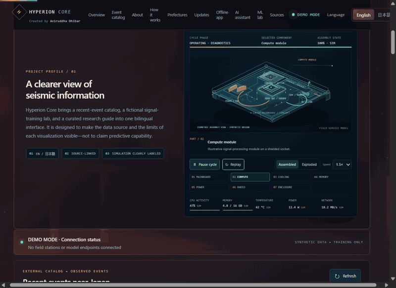
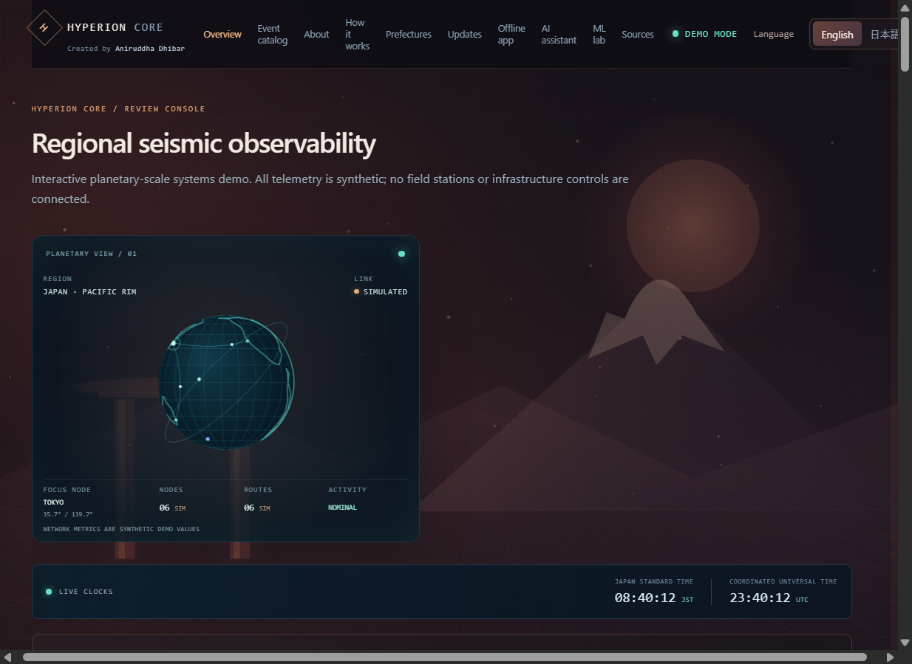
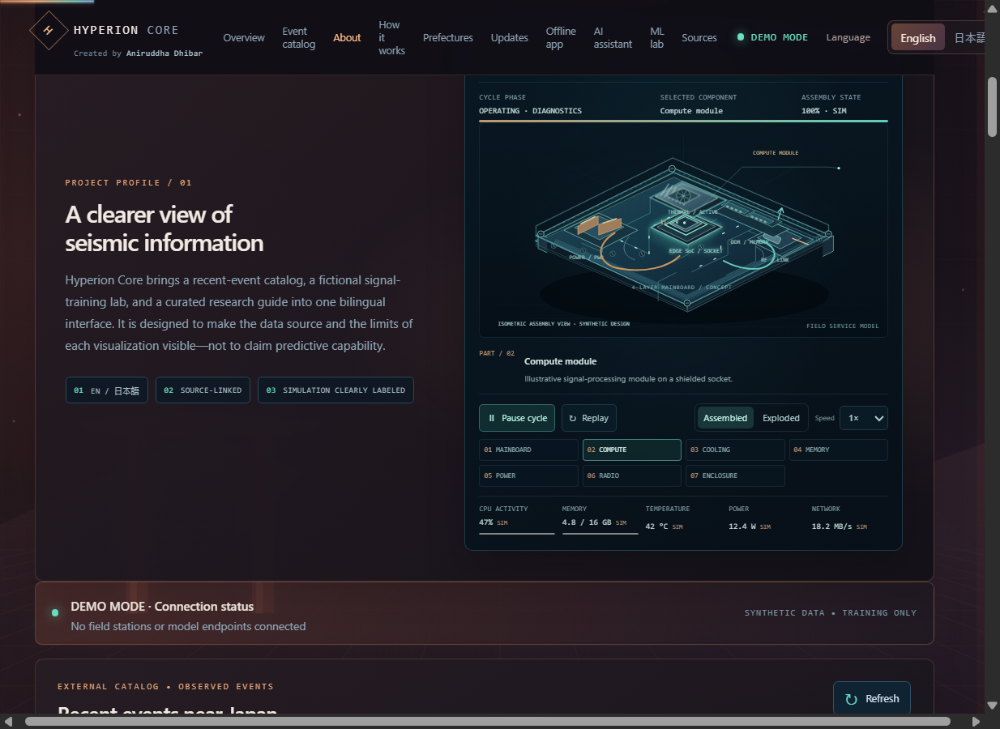

# Hyperion Core

<div align="center">
  <p><strong>JAPAN-FOCUSED SEISMIC OBSERVABILITY · RESEARCH · TRAINING</strong></p>
  <p>A bilingual systems-engineering prototype for exploring public earthquake catalogs, synthetic signal visualizations, and transparent research boundaries.</p>
  <p>
    
    
    
    
  </p>
  <p><strong>Created by Aniruddha Dhibar</strong></p>
  <p><a href="https://hyperion-core-dashboard.onrender.com"></a></p>
</div>

> **Safety notice:** This project is not connected to field sensors, JMA's Earthquake Early Warning (EEW), emergency dispatch, sirens, or infrastructure controls. It must not be used to make emergency or operational decisions. Follow official information from the Japan Meteorological Agency (JMA) and local authorities.

## Dashboard preview

**Open the live dashboard:** [hyperion-core-dashboard.onrender.com](https://hyperion-core-dashboard.onrender.com)

The accelerated screen capture shows the live browser-rendered dashboard and its simulated robotic assembly cycle. These visuals are demonstrations, not sensor recordings.



<p align="center">
  <a href="./docs/media/dashboard-demo.mp4">▶ Watch or download the dashboard video (MP4)</a>
</p>

| Mission-control overview | Robotic hardware console |
| --- | --- |
|  |  |

## What you can explore

- **Japan event catalog:** a server-side proxy retrieves the USGS past-hour GeoJSON feed, filters events to a broad Japan-region bounding box, and presents event time, magnitude, depth, coordinates, and a source link. It auto-refreshes every 60 seconds and shows feed-generation and last-check times.
- **Animated interface:** a Japan-centered globe with mapped coastlines, orbital paths, simulated network nodes and route pulses, plus a robotic edge-computing concept with a choreographed assembly/inspection cycle.
- **About and system tour:** bilingual project context plus a four-step walkthrough separating the USGS catalog from generated training visuals and cited research.
- **Interactive demo reel:** a play/pause scene tour rendered in the browser from the same illustrative globe, waveform, radar, and sensor graphics. It is not a recorded field video.
- **Japan time desk:** live browser-clock views for Japan Standard Time (JST) and UTC.
- **47-prefecture index:** searchable and region-filterable prefecture/capital directory with approximate city-center reference coordinates. These coordinates are not sensor locations.
- **Emergency readiness panel:** links to Tokyo Fire Department 119 guidance and the device phone handler, and states that predictions, sensor telemetry, and emergency-alert delivery are not connected.
- **Installable offline PWA:** caches the app shell and static assets, and stores local notes in browser storage.
- **Local peer communication:** copy/paste WebRTC pairing codes connect two browsers on the same local Wi-Fi/hotspot without cloud signaling. Paired peers can exchange text and use browser audio calls while their local network remains available.
- **Source and update desk:** the latest event in the USGS Japan-region catalog, when present, plus direct links to JMA and USGS primary sources. It does not invent headlines or claim to aggregate official warning news.
- **README language cards:** implemented languages, planned stacks, and their actual repository status are listed below; the dashboard does not render a language-card section.
- **Robotic hardware console:** an interactive isometric concept assembly with selectable components, play/pause, replay, assembled/exploded views, and adjustable animation speed. CPU, memory, temperature, power, and network values are labeled simulated; no physical hardware is read or controlled.
- **Synthetic Nankai training exercise:** replay, pause, reset, and scrub a fictional signal-review sequence; select generated input-noise and station-dropout profiles.
- **Gemini Live voice conversation:** start an opt-in English/Japanese audio conversation or send text, with live transcription and spoken responses. It uses a one-use, short-lived, configuration-constrained token; the permanent Gemini API key stays on the server. Requires your own Gemini API key and a secure context (HTTPS; localhost for development). AI responses are not official alerts, predictions, or emergency advice.
- **Japan preparedness guidance:** an offline curated bilingual answer summarizes earthquake/tsunami basics and Japan's 119 emergency number with links to JMA and Tokyo Fire Department references. It is not dispatch or municipality-specific advice.
- **Synthetic model-training lab:** generate a deterministic toy feature dataset, train a logistic classifier in the browser, review holdout metrics, and export a JSON report. These synthetic scores do not measure real earthquake-prediction skill.
- **Consent-based peer location sharing:** optionally share browser coordinates with the paired peer over the existing local WebRTC data channel. Sharing requires an explicit start action and browser permission, can be stopped at any time, and coordinates are not written to app storage.
- **Local-only message previews:** inspect mock mobile, web, watch, and signage presentations. These are never sent.
- **Polyglot engineering examples:** explore bounded examples and starter modules for sensor framing, DSP, asynchronous inference, scientific modeling, and review eligibility.

All Canvas scenes and the training scenario are illustrative. Animations are not measurements, sensor-status reports, or predictions. The USGS feed contains catalog events that have already been detected and located; it is not a real-time waveform feed or an official Japanese warning channel.

## AI and model cards

| Model / service | Logo card | What the repository actually does |
| --- | --- | --- |
| **Gemini Live API** (`gemini-3.8-live` default) |  | Optional, user-started English/Japanese voice assistant. The model is configurable; it is not an earthquake-prediction model or official alert channel. |
| **Logistic regression** (synthetic browser demo) |  | Trained in-browser on generated toy data to demonstrate a workflow. It has no real seismic training data, pretrained weights, calibration, or predictive value. |
| **Seismic inference model** |  | No validated or pretrained earthquake model is included. The Python service is an adapter interface with no model weights. |

## Run the dashboard

### Deploy on Render

[](https://render.com/deploy?repo=https%3A%2F%2Fgithub.com%2Faniruddhadhibar5-bot%2FApexTectonic)

The repository includes a [`render.yaml`](./render.yaml) Blueprint for the Next.js dashboard. Connect the GitHub repository in Render and create the Blueprint to launch the free web service. Render will build from `apps/dashboard-ui`, run the production Next.js server, and automatically deploy commits pushed to `main`. The first deployment requires signing in to Render and authorizing GitHub. The free instance may spin down while idle and take time to wake.

To enable the optional Gemini Live voice feature, add `GEMINI_API_KEY` as a secret environment variable in the Render dashboard. Never commit the key. Without it, the dashboard still runs, but live voice is unavailable. The dashboard remains a research/demo interface and is not an emergency-warning service.

### Requirements

- Node.js 20 or later
- npm

### Development

```powershell
cd apps/dashboard-ui
npm install
npm run dev
```

Open [http://localhost:3000](http://localhost:3000). The Japan-region catalog is fetched through the Next.js server route at `/api/japan-catalog`; the route contacts the USGS past-hour feed. An internet connection is needed for catalog data. If the external feed is unavailable, the dashboard shows an error rather than substituting synthetic events.

### Configure Gemini Live voice

1. Copy `apps/dashboard-ui/.env.example` to `apps/dashboard-ui/.env.local`.
2. Set `GEMINI_API_KEY` to your own Gemini API key. Keep it server-side; never prefix it with `NEXT_PUBLIC_` or commit `.env.local`.
3. Optionally set `GEMINI_LIVE_MODEL` to a Live API model enabled for your Google AI Studio project.
4. Restart the Next.js development server, open the voice room, review the microphone/data notice, and explicitly select **Start conversation**.

The server mints one-use, short-lived tokens constrained to the configured model and safety instructions. Audio and typed messages are sent to Gemini only during an active, user-started session. The in-process token endpoint limit is a development safeguard, not production abuse prevention; a public deployment needs authenticated access and durable rate limiting. Google Live API availability, quotas, model support, and billing depend on the configured account.

## Install and use the offline communication prototype

1. Open the production deployment over HTTPS while online, then install it from the browser prompt. On iOS/iPadOS, use **Share → Add to Home Screen**. Visit the app once after installation so the service worker caches the shell and static assets.
2. With the internet unavailable, put both devices on the same functioning Wi-Fi or personal hotspot. Each device must have opened the app online and cached it first.
3. Device A selects **Create invite** and shares the generated code with Device B through a private, out-of-band method. Device B pastes it and selects **Accept invite · create response**. Device A pastes the response and selects **Apply peer response**.
4. Once connected, messages travel directly over a WebRTC data channel. Unpaired notes remain local to the device. Both peers select **Start voice call** and grant microphone access to send two-way audio.
5. To share location, select **Share my location** while paired and grant the browser's location permission. Coordinates are sent only to that peer on the local connection, displayed transiently, and cleared when sharing stops or the peer disconnects. Either user can stop sharing; the app does not persist location history.

This prototype uses local ICE candidates only; it has no STUN/TURN server, account, cloud signaling, identity verification, or relay. Pairing may fail if the Wi-Fi network blocks peer-to-peer traffic, the router isolates clients, or the browser cannot resolve local candidates. Both devices need a secure browser context (HTTPS; localhost is suitable for development). Browser geolocation also requires a secure context and explicit permission. Sharing a pairing code grants the recipient a chance to join that room and receive opted-in location—share it only with the intended peer. Local notes are stored unencrypted in browser storage; do not use them for secrets, and clear history on shared devices.

### Offline model-training lab

The dashboard's training lab generates a reproducible synthetic two-class feature dataset and fits a small logistic classifier locally in the browser. The held-out split and exported JSON report are demonstrations of an ML workflow only; there are no real waveform inputs, trained seismic models, calibration results, or earthquake-prediction capability. Do not interpret its metrics as a probability of an earthquake or use them for warnings or decisions.

The voice room can connect to Gemini Live after the operator configures a server-side API key. Starting a session requests microphone permission; live audio and any typed messages are streamed to Google and live transcripts/audio responses are rendered in the browser. The backend mints single-use ephemeral tokens constrained to a fixed model, audio-only output, and a safety-focused system instruction; the permanent API key is never returned to the browser. The token route checks same-origin requests and applies a basic per-process request limit, but has no user authentication or durable cross-instance limiter and must not be exposed publicly without those controls. Gemini Live is an external preview service and may be unavailable, change, incur charges, or produce incorrect answers. The assistant is not an official warning channel or earthquake predictor; follow JMA/local-authority instructions and do not use it for emergency decisions. No session transcript is intentionally persisted by the app.

The PWA cannot create Wi-Fi, use Wi-Fi Direct or Bluetooth for calling, or bypass a loss of telephone service. A cellular call to 119 still requires an available telephone network. This prototype is not an emergency dispatch, guaranteed communications, or life-safety service; test it only with non-emergency messages.

### Production build

```powershell
cd apps/dashboard-ui
npm run typecheck
npm run build
npm run start
```

## Repository map

| Path | Purpose | Scope |
| --- | --- | --- |
| `apps/dashboard-ui/` | Bilingual Next.js dashboard and Japan catalog API route | Interactive review and training UI |
| `apps/dashboard-ui/src/app/api/japan-catalog/` | USGS feed fetch, validation, Japan-region filter | Catalog proxy; not an alert API |
| `services/edge-sensor/` | Borrowed-frame parser and keyed HMAC-SHA3 authentication-tag example | No I2C/SPI hardware driver |
| `services/zig-kernel-driver/` | Bounded fixed-frame decoder | No raw sockets, kernel driver, or network bypass |
| `services/dsp-engine/` | Scalar radix-2 FFT and cascaded Butterworth sections | C++ example; no SIMD guarantee |
| `services/julian-tectonics/` | Stable, dimensionless diffusion example | Not a geophysical forecast |
| `services/ai-core/` | Bounded asynchronous inference adapter | No model weights or validated predictor |
| `services/verifier/` | Deterministic candidate review-eligibility checks | Not a formal safety proof |
| `proto/sentinel.proto` | Shared telemetry and review contract | Code generation is not configured |
| `packages/wasm-dsp/` | Reserved for a future separately validated WASM build | No WASM binary is shipped |
| `config/` | Local development configuration | Not production secrets or deployment settings |
| `docker-compose.yml` | Local Redpanda development broker | No actuator or public-warning integration |
| `Makefile` | Available polyglot test commands | Requires the corresponding language toolchains |

This is a deliberately scoped starter, not a finished implementation of every language or service in the original concept. Hardware interfaces, production gRPC services, trained models, authentication, deployment hardening, observability, and emergency integrations are not provided.

## Polyglot architecture inventory

The cards below distinguish languages with source code in this repository from proposed stacks. An implementation card means a bounded example or scaffold exists—not that the service is production-ready, deployed, or connected to real sensors.

<table>
  <tr>
    <td align="center" width="12.5%"><br><sub>Edge frame parser<br>Example</sub></td>
    <td align="center" width="12.5%"><br><sub>Bounded frame decoder<br>Example</sub></td>
    <td align="center" width="12.5%"><br><sub>FFT and filters<br>Scalar DSP</sub></td>
    <td align="center" width="12.5%"><br><sub>Scientific example<br>Not a forecast</sub></td>
    <td align="center" width="12.5%"><br><sub>Async inference adapter<br>No weights</sub></td>
    <td align="center" width="12.5%"><br><sub>Review checks<br>Not a proof</sub></td>
    <td align="center" width="12.5%"><br><sub>Routing example<br>Not a mesh</sub></td>
    <td align="center" width="12.5%"><br><sub>Dashboard styling<br>Implemented</sub></td>
  </tr>
  <tr>
    <td align="center"><br><sub>Review queue<br>No actuators</sub></td>
    <td align="center"><br><sub>Statistical example<br>Not a risk estimate</sub></td>
    <td align="center"><br><sub>Admin scaffold<br>Minimal</sub></td>
    <td align="center"><br><sub>Next.js dashboard<br>Implemented</sub></td>
    <td align="center"><br><sub>Browser interactions<br>Implemented</sub></td>
    <td align="center"><br><sub>Web UI markup<br>Implemented</sub></td>
    <td align="center"><br><sub>Async client example<br>No push delivery</sub></td>
  </tr>
</table>

**Planned or reserved—not counted as implemented languages:** Elixir (no service scaffold), Dart/Flutter (no app scaffold), and WebAssembly (reserved package, no compiled binary). The original “R++” idea is treated as an Rcpp/C++ integration concept only; no Rcpp bridge exists.

The shared service contract is defined with Protocol Buffers in [`proto/sentinel.proto`](./proto/sentinel.proto); the schema language is an interface definition, not an additional programming-language card.

## Japan region directory

The dashboard lists every prefecture and its capital-city reference coordinates, grouped into eight conventional regions: Hokkaido, Tohoku, Kanto, Chubu, Kansai, Chugoku, Shikoku, and Kyushu/Okinawa. The coordinates are approximate city-center references. They are provided for geographic orientation only and do not indicate sensor placement, seismic coverage, local hazard, or current conditions.

The USGS catalog filter uses a broad rectangular geographic window, not Japanese administrative boundaries. An event’s appearance or absence in this catalog must not be interpreted as a local safety status.

The emergency readiness panel links to the [Tokyo Fire Department's 119 call guidance](https://www.tfd.metro.tokyo.lg.jp/lfe/119/index.html). Its `tel:119` link asks the device to open its phone handler; this site cannot place calls, dispatch ambulances, or provide communications when telephone service is unavailable. Offline voice/text requires a working communication path such as cellular, satellite, or dedicated radio/mesh equipment.

## Research and development

See the project’s [Research & Development brief](./docs/RESEARCH_AND_DEVELOPMENT.md) for the architecture boundaries, source ledger, research questions, staged validation plan, and explicit data gaps. It is a project design note—not a peer-reviewed geophysical study or evidence of predictive performance.

## Checks

The dashboard checks can be run independently:

```powershell
cd apps/dashboard-ui
npm run typecheck
npm run build
```

The repository-level `make test` target runs the available Rust, Python, C++, Zig, Julia, Haskell, and dashboard checks. Install the relevant toolchains first; the aggregate target will fail when a required compiler or runtime is missing. Individual commands are listed in the [Makefile](./Makefile).

## Data sources

- [USGS Earthquake Hazards Program — real-time feeds](https://earthquake.usgs.gov/earthquakes/feed/v1.0/)
- [USGS FDSN Event Web Service](https://earthquake.usgs.gov/fdsnws/event/1/)
- [JMA — Earthquake Early Warning overview](https://www.jma.go.jp/jma/en/Activities/eew1.html)
- [JMA — EEW limitations](https://www.jma.go.jp/jma/en/Activities/eew3.html)
- [NIED Hi-net — data information and terms](https://www.hinet.bosai.go.jp/about_data/?LANG=en)

The catalog API uses the USGS `all_hour.geojson` feed and filters coordinates to latitude 24–46° N and longitude 122–154° E. This broad geographic filter is a display convenience, not an authoritative Japan boundary. Feed reporting may be delayed or incomplete. Respect each provider's terms; this project does not ingest or republish Hi-net waveforms.

## Safety and scientific limits

- No earthquake prediction is made. Neither this prototype nor its example models can promise a future event's time, location, magnitude, or a zero false-positive rate.
- The USGS catalog is not JMA EEW. EEW is an official service based on observed seismic waves after an earthquake has begun; this project neither receives nor reproduces it.
- The UI has no live station telemetry, calibrated model, evacuation guidance, public push delivery, siren control, or infrastructure actuator.
- The Nankai scenario, waveforms, topology links, radar dimensions, sensor rendering, and public-message cards are locally generated demonstrations.
- The Python adapter has no validated model weights or field dataset. The Julia example is not a tectonic forecast, and the Haskell checks do not prove zero-false-positive behavior or actuator safety.
- The Zig example does not bypass host network controls or attach privileged kernel/network drivers.

Any operational or public-safety use would require qualified seismological review, validated and calibrated models, field testing, independent safety assessment, secure device provisioning, authorization by relevant agencies, and fail-safe procedures.

## Development broker

`docker-compose.yml` starts a local Redpanda broker for development only. Do not expose it to untrusted networks. It is not connected to public warnings or infrastructure controls.

---

**Hyperion Core · Created by Aniruddha Dhibar**
